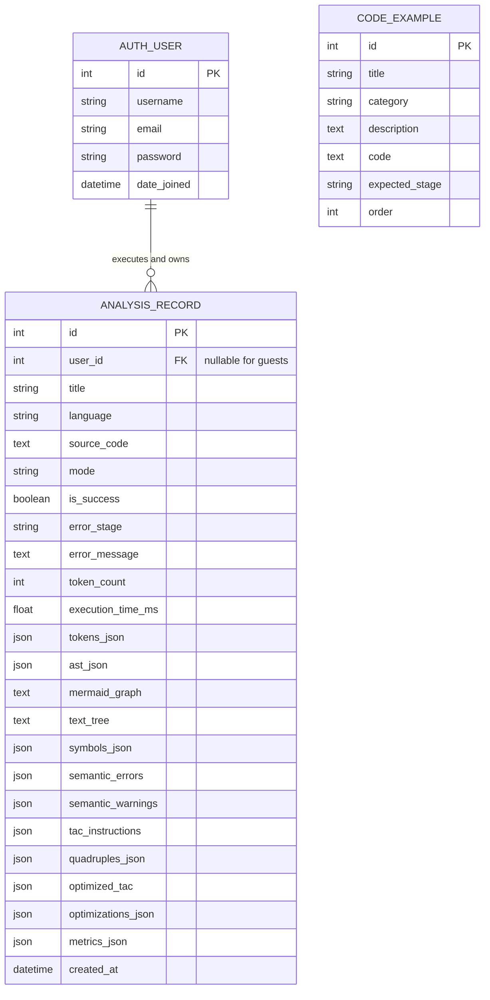

# CodeCraft: An Interactive Compiler Design and Code Analysis Platform

[](https://www.djangoproject.com/)
[](https://www.python.org/)
[](https://sqlite.org/)
[](https://getbootstrap.com/)
[]()

**CodeCraft** is a dynamic full-stack web application and interactive educational developer tool designed for Third-Year Bachelor of Engineering (B.E.) Computer Science and Engineering students for the **Compiler Design Technical Evaluation Component (TEC) Assignment** (Semester V).

Unlike static documentation or basic CLI tools, CodeCraft provides a sandboxed, real-time visual environment for exploring all major phases of the classical compiler pipeline:
1. **Lexical Analysis (Scanner)** with token coordinates, categories, and lexical error recovery.
2. **Syntax Analysis (Predictive Recursive-Descent Parser)** producing navigable Abstract Syntax Trees (AST) rendered interactively via Mermaid.js diagrams, ASCII trees, and JSON.
3. **Semantic Analysis & Symbol Table** tracking nested block scopes, variable declarations, memory byte footprints, uninitialized variable warnings, and compile-time type compatibility.
4. **Intermediate Code Generation (ICG)** linearizing expressions into Three-Address Code (TAC) and 4-tuple Quadruple records `(Op, Arg1, Arg2, Result)`.
5. **Machine-Independent Code Optimization** performing compile-time Constant Folding and Algebraic Identity Simplification.
6. **Analytics Dashboard & Persistent History** safely isolating user experiment logs in SQLite with Chart.js visualization.

---

## 1. System Architecture & Compiler Flowcharts

### A. Classical Compiler Pipeline Flowchart

```mermaid
flowchart TD
    A["Raw Edu-C Source Code"] --> B["Lexical Analyzer (Lexer)"]
    B -->|Token Stream & Position Coordinates| C["Syntax Analyzer (Recursive-Descent Parser)"]
    C -->|Abstract Syntax Tree (AST)| D["Semantic Analyzer & Symbol Table"]
    D -->|Type-Checked AST & Multi-Scope Table| E["Intermediate Code Generator (ICG)"]
    E -->|Three-Address Code & Quadruples| F["Machine-Independent Optimizer"]
    F -->|Constant Folded TAC & Identities| G["Interactive Workbench Outputs"]

    B -.->|Lexical Errors| ERR["Error Diagnostics Panel"]
    C -.->|Syntax Errors| ERR
    D -.->|Semantic Errors & Warnings| ERR
```

### B. Django Full-Stack Application Architecture

```mermaid
graph TD
    User["Web Browser Client"] -->|HTTP / AJAX POST (CSRF)| Router["Django URL Router (urls.py)"]
    
    subgraph "Django Application Layer"
        Router --> Auth["accounts (Authentication & Profiles)"]
        Router --> Lab["compiler_lab (Workbench IDE & History API)"]
        Router --> Dash["dashboard (Chart.js Metrics & Analytics)"]
        Router --> Learn["learning (Educational Theory & BNF)"]
    end

    subgraph "Compiler Engine (compiler_lab/engine/)"
        Lab --> Pipeline["CompilerPipeline Coordinator"]
        Pipeline --> Lexer["Lexer (tokens.py & lexer.py)"]
        Pipeline --> Parser["Recursive-Descent Parser (parser.py)"]
        Pipeline --> Semantic["SemanticAnalyzer (semantic.py)"]
        Pipeline --> Codegen["CodeGenerator (codegen.py)"]
        Pipeline --> Optimizer["TACOptimizer (optimizer.py)"]
    end

    subgraph "Persistence Layer"
        Lab --> ORM["Django ORM Models"]
        Auth --> ORM
        ORM --> DB[("SQLite Database (db.sqlite3)")]
    end
```

---

## 2. Language Specification: Edu-C Subset & Formal BNF Grammar

CodeCraft implements a clearly defined, documented subset of a C-like programming language (**Edu-C**). It intentionally focuses on fundamental programming paradigms while maintaining strict execution safety.

### A. Supported Language Constructs
- **Primitive Data Types:** `int`, `float`, `char`, `string`, `bool`, `void`
- **Variable Declarations:** Typed definitions with optional initialization (`int x = 10;`, `float rate;`)
- **Assignments:** Simple assignment (`=`) and compound operators (`+=`, `-=`, `*=`, `/=`)
- **Arithmetic Operators:** Addition (`+`), subtraction (`-`), multiplication (`*`), division (`/`), modulo (`%`)
- **Relational Operators:** Equality (`==`, `!=`), ordering (`<`, `<=`, `>`, `>=`)
- **Logical Operators:** Conjunction (`&&`), disjunction (`||`), negation (`!`)
- **Control Flow:** Conditional branching (`if-else`), iterative looping (`while`)
- **Compound Blocks:** Lexical scoping with nested braces (`{ ... }`)
- **Comments:** Single-line (`// ...`) and multi-line comments (`/* ... */`)

### B. Intentionally Excluded Constructs
To ensure educational clarity and execution safety:
- Preprocessor macros (`#include`, `#define`) are excluded.
- Raw pointers (`*ptr`, `&var`) and manual memory management (`malloc`) are omitted.
- Composite structs and unions are not included in this educational subset.

### C. Formal BNF Grammar

```ebnf
<program>            ::= <statement_list>
<statement_list>     ::= <statement> <statement_list> | ε

<statement>          ::= <var_decl>
                       | <assignment_stmt>
                       | <if_stmt>
                       | <while_stmt>
                       | <return_stmt>
                       | <block>
                       | <expr_stmt>
                       | ';'

<var_decl>           ::= <type> IDENTIFIER ( '=' <expression> )? ';'
<type>               ::= 'int' | 'float' | 'char' | 'string' | 'bool' | 'void'

<assignment_stmt>    ::= IDENTIFIER <assign_op> <expression> ';'
<assign_op>          ::= '=' | '+=' | '-=' | '*=' | '/='

<if_stmt>            ::= 'if' '(' <expression> ')' <statement> ( 'else' <statement> )?
<while_stmt>         ::= 'while' '(' <expression> ')' <statement>
<return_stmt>        ::= 'return' ( <expression> )? ';'
<block>              ::= '{' <statement_list> '}'
<expr_stmt>          ::= <expression> ';'

<expression>         ::= <logical_or>
<logical_or>         ::= <logical_and> ( '||' <logical_and> )*
<logical_and>        ::= <equality> ( '&&' <equality> )*
<equality>           ::= <relational> ( ( '==' | '!=' ) <relational> )*
<relational>         ::= <additive> ( ( '<' | '<=' | '>' | '>=' ) <additive> )*
<additive>           ::= <multiplicative> ( ( '+' | '-' ) <multiplicative> )*
<multiplicative>     ::= <unary> ( ( '*' | '/' | '%' ) <unary> )*
<unary>              ::= ( '!' | '-' | '+' ) <unary> | <primary>

<primary>            ::= IDENTIFIER
                       | INT_LITERAL
                       | FLOAT_LITERAL
                       | STRING_LITERAL
                       | CHAR_LITERAL
                       | 'true' | 'false'
                       | '(' <expression> ')'
```

---

## 3. Database Schema & Entity Relationships

The database utilizes SQLite 3 managed via Django ORM migrations.



### Ownership Isolation
Every `AnalysisRecord` links to the authenticated `User` who created it. The history views enforce strict authorization checks:
- A user can only view, query, export, and delete records where `record.user == request.user`.
- Access attempts by unauthorized users return a clean `404 Not Found` rather than leaking record existence.

---

## 4. Example Inputs and Actual Compilation Outputs

### Example 1: Arithmetic Expression & Precedence

#### Source Input:
```c
int a = 15;
int b = 4;
int c = 2;
int result = (a + b) * c - 8 / 2;
```

#### Lexical Output (Sample Tokens):
| Token # | Lexeme | Category | Line | Column |
|---|---|---|---|---|
| 1 | `int` | KEYWORD | 1 | 1 |
| 2 | `a` | IDENTIFIER | 1 | 5 |
| 3 | `=` | OP_ASSIGNMENT | 1 | 7 |
| 4 | `15` | INT_LITERAL | 1 | 9 |
| 5 | `;` | SEPARATOR | 1 | 11 |

#### Generated Three-Address Code (TAC):
```text
a = 15
b = 4
c = 2
t0 = a + b
t1 = t0 * c
t2 = 8 / 2
t3 = t1 - t2
result = t3
```

#### Quadruples Table:
| Index | Op | Arg1 | Arg2 | Result |
|---|---|---|---|---|
| (0) | `=` | `15` | `-` | `a` |
| (1) | `=` | `4` | `-` | `b` |
| (2) | `=` | `2` | `-` | `c` |
| (3) | `+` | `a` | `b` | `t0` |
| (4) | `*` | `t0` | `c` | `t1` |
| (5) | `/` | `8` | `2` | `t2` |
| (6) | `-` | `t1` | `t2` | `t3` |
| (7) | `=` | `t3` | `-` | `result` |

#### Applied Code Optimization (Constant Folding):
```text
Optimization: Constant Folding on (8 / 2) -> 4
Original Instruction: t2 = 8 / 2
Optimized Instruction: t2 = 4
```

---

## 5. Local Setup and Installation Guide

### Prerequisites
- Python 3.10, 3.11, 3.12, or 3.13 installed
- Git installed
- SQLite3 (included with Python standard library)

### Step 1: Clone the Repository
```bash
git clone https://github.com/your-username/CodeCraft.git
cd CodeCraft
```

### Step 2: Create and Activate Virtual Environment
```bash
# Windows
python -m venv venv
.\venv\Scripts\activate

# macOS / Linux
python3 -m venv venv
source venv/bin/activate
```

### Step 3: Install Dependencies
```bash
pip install -r requirements.txt
```

### Step 4: Configure Environment Variables
Copy `.env.example` to `.env`:
```bash
# Windows PowerShell
copy .env.example .env

# macOS / Linux
cp .env.example .env
```

### Step 5: Run Database Migrations
```bash
python manage.py migrate
```
*(This automatically creates all database tables and seeds the curated educational assignment presets).*

### Step 6: Create Superuser (Admin) Account
```bash
python manage.py createsuperuser
```
*Or use the pre-configured demo student account (`student` / `StudentPassword2026!`).*

### Step 7: Run Automated Tests
```bash
python manage.py test
```
*Expected: 27 tests passing with `OK` status.*

### Step 8: Start the Local Development Server
```bash
python manage.py runserver 127.0.0.1:8000
```
Open your browser and navigate to: **`http://127.0.0.1:8000/`**

---

## 6. Pre-Configured Demo Accounts

For immediate local demonstration and evaluation:

| Role | Username | Password | Access Privileges |
|---|---|---|---|
| **Admin Superuser** | `admin` | `AdminPassword2026!` | Full Django Admin & Laboratory |
| **Student Demo** | `student` | `StudentPassword2026!` | Pre-seeded Dashboard & History |

---

## 7. Deployment Instructions

CodeCraft is pre-configured with Whitenoise and Gunicorn for rapid production deployment on major Python hosting services:

### A. Deploy to Render
1. Push code to your GitHub repository.
2. In Render, select **New Web Service** and connect your repo.
3. Configure settings:
   - **Environment:** `Python 3`
   - **Build Command:** `pip install -r requirements.txt && python manage.py migrate && python manage.py collectstatic --noinput`
   - **Start Command:** `gunicorn codecraft.wsgi:application --bind 0.0.0.0:$PORT`
4. Add environment variables in Render:
   - `DEBUG=False`
   - `SECRET_KEY=your-production-random-secret-key`
   - `ALLOWED_HOSTS=.onrender.com`

### B. Deploy to PythonAnywhere
1. Create a Python 3.13 manual configuration Web App.
2. Clone repository into `/home/yourusername/CodeCraft`.
3. In Virtualenv section, point to your virtual environment.
4. Set WSGI file to load `codecraft.wsgi`.

---

## 8. GitHub Publishing Guide

To publish this project to your GitHub account:

```bash
# Initialize git (if not already done)
git init

# Check status
git status

# Add all files
git add .

# Create initial commit
git commit -m "feat: complete dynamic CodeCraft compiler design and analysis platform"

# Set main branch
git branch -M main

# Add your remote repository URL
git remote add origin https://github.com/<your-github-username>/CodeCraft.git

# Push to GitHub
git push -u origin main
```

---

## 9. Academic Project Metadata

- **Course Title:** Compiler Design (CS305 / TEC)
- **Degree Program:** Bachelor of Engineering in Computer Science and Engineering (B.E. CSE)
- **Year / Semester:** Third Year / Fifth Semester
- **Component:** Technical Evaluation Component (TEC) Assignment
- **Platform Name:** CodeCraft Interactive Compiler Design Lab
